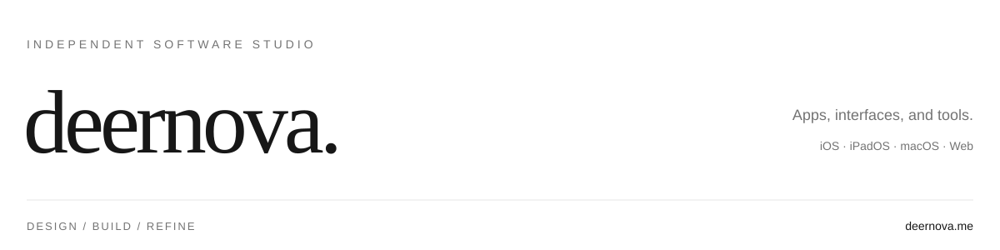

<a href="https://deernova.me">
  <picture>
    <source media="(prefers-color-scheme: dark)" srcset="https://raw.githubusercontent.com/deernova-studio/.github/main/profile/assets/cover-dark.svg">
    
  </picture>
</a>

  <a href="https://deernova.me">网站</a> &nbsp; / &nbsp;
  <a href="https://deernova.me/guide.html">设计规范</a> &nbsp; / &nbsp;
  <a href="https://github.com/deernova-studio/deernova-style">Deernova Style</a>

### Deernova Style

给人和 AI 使用的界面设计规范。以黑白灰、清晰的层次和原生体验，连接 Web、macOS、iOS 与 iPadOS。

设计原则、组件规格、设计变量，以及可安装到项目中的 agent skill，都在同一份规范里。

[浏览规范 ↗](https://deernova.me/guide.html) &nbsp; · &nbsp; [查看仓库 ↗](https://github.com/deernova-studio/deernova-style)
